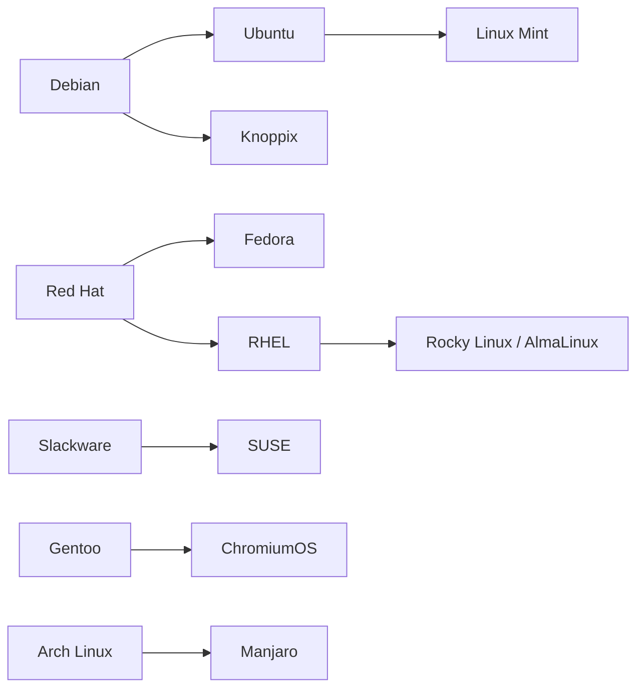
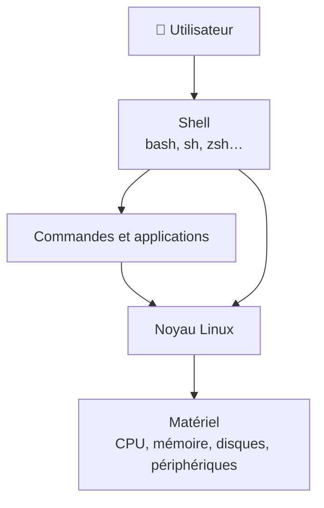

[Sommaire](Readme.md) · [Chapitre suivant →](02-Premiers-pas-et-aide.md)

# Présentation de Linux

Unix est le premier système d'exploitation à ne pas avoir été conçu par un
constructeur de matériel : il a ouvert une brèche dans un domaine jusque-là
propriétaire et réservé. **Linux**, ou **GNU/Linux**, est une famille de
systèmes d'exploitation open source de type Unix, fondée sur le noyau Linux
créé en 1991 par Linus Torvalds. Ses nombreuses distributions ont largement
contribué à populariser le logiciel libre.

## 🎯 Objectifs du chapitre

- Situer Linux dans l'histoire d'Unix
- Distinguer les distributions et leurs familles
- Comprendre les licences libres et la différence entre licence et support
- Connaître les composants d'un système Linux et son arborescence

---

## 1. Historique

- **1971** : première version d'Unix aux Bell Labs, sur un PDP-11/20 doté de 24 Ko de RAM (dont 16 occupés par le noyau) et de 512 Ko de disque.
- **1973** : Ken Thompson et Dennis Ritchie réécrivent le noyau Unix en **langage C**, ce qui le rend portable ; l'université de Berkeley est l'une des premières à en obtenir les sources.
- **1975-1976** : Unix *Version 6*, première version largement diffusée, notamment dans les universités.
- **1982** : SunOS 1.0.
- **1983** : lancement du projet **GNU**.
- **1991** : naissance du **noyau Linux**, diffusé sur les premiers serveurs FTP.
- **1993** : naissance des distributions **Slackware** et **Debian**.
- **1996** et **1997** : sorties des environnements de bureau **KDE** puis **GNOME**.
- **2004** : première version d'**Ubuntu**.

---

## 2. Distributions et familles

### Qu'est-ce qu'une distribution ?

Une **distribution** GNU/Linux est un ensemble cohérent de logiciels qui
réunit le **noyau Linux**, des logiciels du **projet GNU** et des logiciels
tiers, avec un installateur et un gestionnaire de paquets. Certaines sont
orientées poste de travail (Ubuntu), d'autres serveur (Red Hat Enterprise
Linux).

On en recense plusieurs centaines ; la frise de leur généalogie est
disponible sur <https://github.com/FabioLolix/LinuxTimeline>. Certaines sont
commerciales (Red Hat, SUSE), d'autres à but non lucratif (Debian).

### Les familles

Beaucoup de distributions dérivent d'une autre :



Les principales familles : **Debian**, **Red Hat**, **Slackware**,
**Gentoo**, **Arch Linux**.

### En entreprise

| Usage | Distributions courantes |
|---|---|
| Serveurs | Red Hat Enterprise Linux, Rocky Linux / AlmaLinux (successeurs de CentOS), Debian, Ubuntu Server |
| Postes de travail | Ubuntu Desktop |

### Red Hat ou Debian ?

| | Red Hat Enterprise Linux | Debian |
|---|---|---|
| Modèle | commercial, open source, éditée par Red Hat (IBM) qui vend souscriptions et support | communautaire, gratuit, porté par le projet Debian, à but non lucratif |
| Cycle | versions majeures espacées, maintenues une dizaine d'années | versions stables tous les deux ans environ |
| Paquets | `.rpm`, gestionnaire `rpm`, résolveur `dnf` (successeur de `yum`) | `.deb`, gestionnaire `dpkg`, résolveur `apt` |
| Logithèque | sélection restreinte et certifiée | plus de 60 000 paquets |
| Points forts | support éditeur, certifications des logiciels métier | stabilité, liberté, communauté très active |

---

## 3. Licences et support

### GNU

En 1983, **Richard Stallman**, chercheur au MIT, lance le projet **GNU**
(*GNU's Not Unix*) : réécrire un système d'exploitation libre, compatible
Unix. De nombreux outils sont réécrits « from scratch ». Le noyau est la
partie la plus longue à aboutir : c'est le noyau **Linux** de Linus Torvalds,
en 1991, qui complète le système et rend possible la diffusion de
distributions entièrement libres.

### Free Software Foundation

Fondée en 1985 par Richard Stallman, la **FSF** finance puis défend les
logiciels libres et leurs utilisateurs. Pour Stallman, *free* désigne la
**liberté**, pas la gratuité.

### La licence GPL et le copyleft

La **GNU GPL** (*General Public License*) protège les logiciels libres en
empêchant qu'on se les approprie. Le terme **copyleft** désigne les licences
qui suivent ce principe. Elles garantissent :

- la liberté d'**exécuter** le logiciel pour tout usage ;
- la liberté d'**accéder** au code source ;
- la liberté d'**étudier** le fonctionnement du logiciel ;
- la liberté de le **modifier** pour l'adapter à ses besoins ;
- la liberté de **redistribuer** des copies ;
- l'obligation de redistribuer sous **la même licence** les versions modifiées.

### Libre, gratuit, open source

- Un **gratuiciel** (*freeware*) est un logiciel propriétaire gratuit ; un logiciel libre se définit par les libertés accordées, pas par le prix. Le libre est souvent gratuit, mais il peut être rentabilisé par des services : support, hébergement…
- L'**open source** met l'accent sur une méthode de développement fondée sur l'ouverture et la réutilisation du code source.

### Autres licences

| Licence | Principe |
|---|---|
| **LGPL** (*Lesser GPL*, anciennement *Library GPL*) | moins restrictive que la GPL ; souvent utilisée pour les bibliothèques, qui peuvent alors être liées à des logiciels non libres |
| **BSD** | très permissive : réutilisation sans restriction, y compris dans un logiciel propriétaire. Sa clause de publicité d'origine a disparu des versions récentes |

### Licence ou support ?

Une **licence** fixe les droits d'utilisation du logiciel ; le **support**
est un **contrat de service** : assistance technique, mises à jour garanties,
ressources en ligne. On peut parfaitement utiliser un logiciel libre et
gratuit avec un support payant — c'est le modèle de Red Hat.

---

## 4. Les composants de Linux



### Le noyau

Le **noyau** est le cœur du système. Il :

- gère les ressources de l'ordinateur (périphériques, stockage, CPU, mémoire) ;
- met ces ressources à disposition des utilisateurs et des programmes ;
- **ordonnance** les processus.

### Le shell

Une commande est une suite de mots séparés par des espaces : le premier est
le **nom de la commande**, les suivants ses **arguments**.

```bash
ls -l /etc
# ^   ^   ^
# |   |   └ argument
# |   └ option
# └ commande
```

La commande est analysée et interprétée par un **interpréteur de commandes**,
le **shell**, qui est aussi un langage complet : on peut enregistrer des
suites de commandes dans des **scripts shell**.

Le shell lit ce qu'on lui fournit sur son **entrée standard** (*stdin*, le
clavier), écrit ses résultats sur la **sortie standard** (*stdout*, l'écran)
et ses erreurs sur la **sortie d'erreur** (*stderr*, l'écran aussi) — voir le
[chapitre 08](08-Redirections-et-pipes.md).

| Shell | Origine |
|---|---|
| **sh** (Bourne Shell) | AT&T |
| **csh** (C Shell) | Unix BSD, syntaxe proche du C |
| **ksh** (Korn Shell) | AT&T, sur-ensemble de sh qui reprend des apports de csh |
| **bash** (Bourne-Again Shell) | projet GNU, fondé sur sh ; shell par défaut de la plupart des distributions |

### L'arborescence de fichiers

Sous Linux, **tout est fichier** : répertoires, programmes, périphériques,
informations système… tout est représenté comme un fichier.

L'arborescence part d'une **racine** unique, notée `/`. Les règles de
nommage :

- **pas d'extension** obligatoire : `.txt` n'aide que l'humain ;
- tous les caractères sont permis sauf `/` ; mieux vaut éviter espaces et caractères spéciaux ;
- **sensible à la casse** : `BONJOUR`, `bonjour` et `Bonjour` sont trois fichiers différents ;
- les fichiers **cachés** commencent par un point : `.bashrc` ;
- un nom peut compter jusqu'à **255 caractères**.

L'organisation des répertoires suit une norme, la **FHS** (*Filesystem
Hierarchy Standard*) :

| Répertoire | Contenu |
|---|---|
| `/bin` | binaires des commandes essentielles |
| `/boot` | fichiers statiques du chargeur d'amorçage, noyau |
| `/dev` | fichiers de périphériques |
| `/etc` | configuration du système |
| `/home` | répertoires personnels des utilisateurs |
| `/lib` | bibliothèques partagées et modules du noyau |
| `/media` | points de montage des supports amovibles |
| `/mnt` | point de montage temporaire |
| `/opt` | logiciels additionnels |
| `/proc` | système de fichiers virtuel : informations sur les processus et le noyau |
| `/root` | répertoire personnel de l'utilisateur root |
| `/run` | données variables d'exécution |
| `/sbin` | exécutables système essentiels (administration) |
| `/srv` | données des services fournis par le système |
| `/sys` | système de fichiers virtuel : informations sur le matériel |
| `/tmp` | fichiers temporaires |
| `/usr` | hiérarchie secondaire : programmes et bibliothèques des utilisateurs |
| `/var` | données variables : journaux, files d'attente, caches |

---

## 5. Configuration minimale

Pour installer une distribution de bureau légère (Debian avec un bureau
simple) :

| Ressource | Minimum |
|---|---|
| Processeur | 1 GHz, 64 bits |
| RAM | 1 Go (2 Go et plus recommandés) |
| Disque | 20 Go |

Un serveur sans interface graphique se contente de bien moins.

---

## ✅ Vérifier ses acquis

1. Que désigne précisément le mot « Linux » ? Pourquoi parle-t-on aussi de « GNU/Linux » ?
2. Citez deux libertés garanties par la GPL, et l'obligation qu'elle impose.
3. Dans quel répertoire trouve-t-on la configuration du système ? Les journaux ?

<details>
<summary>Voir la correction</summary>

1. Linux est le noyau. Un système complet associe ce noyau aux outils du projet GNU, d'où « GNU/Linux ».
2. Au choix : exécuter, accéder au code, étudier, modifier, redistribuer. Obligation : redistribuer les versions modifiées sous la même licence.
3. `/etc` pour la configuration, `/var/log` pour les journaux.

</details>

---

[Sommaire](Readme.md) · [Chapitre suivant →](02-Premiers-pas-et-aide.md)
