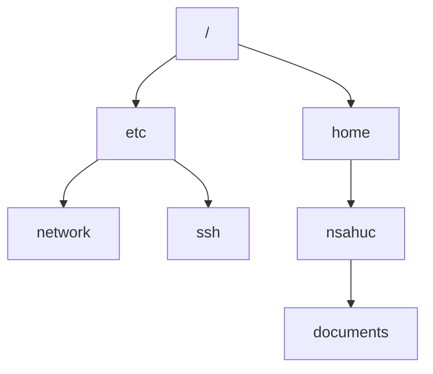

[← Chapitre précédent](02-Premiers-pas-et-aide.md) · [Sommaire](Readme.md) · [Chapitre suivant →](04-Rechercher-grep-find.md)

# Fichiers et répertoires

## 🎯 Objectifs du chapitre

- Se repérer et se déplacer dans l'arborescence
- Distinguer chemin absolu et chemin relatif
- Créer, copier, déplacer, supprimer fichiers et répertoires
- Afficher le contenu d'un fichier de différentes manières

---

## 1. Se repérer et se déplacer

### Où suis-je ?

```bash
pwd         # affiche le répertoire courant, par exemple /home/nsahuc
```

### Changer de répertoire

```bash
cd /etc/network     # chemin absolu
cd ..               # remonter d'un niveau
cd                  # revenir dans son répertoire personnel
cd -                # revenir au répertoire précédent
```

### Chemin absolu, chemin relatif

| | Commence par | Exemple | Valable depuis |
|---|---|---|---|
| **Absolu** | `/` (la racine) | `/etc/network/interfaces` | n'importe où |
| **Relatif** | autre chose | `../network/interfaces` | le répertoire courant |

Raccourcis : `.` désigne le répertoire courant, `..` le répertoire parent,
`~` le répertoire personnel.



Depuis `/etc/ssh`, le chemin relatif vers `/etc/network` est `../network`.

---

## 2. Lister

```bash
ls              # contenu du répertoire courant
ls -l /etc      # format long
ls -la          # format long, fichiers cachés compris
ls -ltr         # tri par date, du plus ancien au plus récent
```

| Option | Effet |
|---|---|
| `-a` | inclure les fichiers cachés (commençant par `.`) |
| `-l` | format long : type, permissions, propriétaires, taille, date |
| `-h` | tailles lisibles (Ko, Mo…) avec `-l` |
| `-r` | inverser le tri |
| `-t` | trier par date de dernière modification |

### L'espace occupé

```bash
du -sh /var/log     # taille totale d'un répertoire, lisible
```

| Option | Effet |
|---|---|
| `-h` | *human-readable* : Ko, Mo, Go… |
| `-s` | *summarize* : un seul total par argument |

---

## 3. Manipuler fichiers et répertoires

| Action | Commande |
|---|---|
| Créer un répertoire | `mkdir nom` (`-p` : créer aussi les parents) |
| Supprimer un répertoire **vide** | `rmdir nom` |
| Créer un fichier vide, ou mettre à jour sa date | `touch fichier` |
| Copier | `cp source cible` (`-r` pour un répertoire) |
| Déplacer ou renommer | `mv source cible` |
| Supprimer | `rm fichier` (`-r` pour un répertoire et son contenu) |
| Connaître le type d'un fichier | `file fichier` |

> ⚠️ Sous Linux, il n'y a **pas de corbeille** en ligne de commande. `rm -r`
> est définitif. Relisez la commande avant d'appuyer sur Entrée, surtout en
> root.

---

## 4. Afficher du texte

### `cat` : afficher et concaténer

```bash
cat fichier                     # afficher
cat -n fichier                  # numéroter les lignes
cat fichier1 fichier2 > tout    # concaténer dans un nouveau fichier
cat > note.txt                  # saisir un contenu, terminer par Ctrl+D
```

| Option | Effet |
|---|---|
| `-n` | numéroter toutes les lignes |
| `-b` | numéroter les lignes non vides |
| `-s` | fusionner les lignes vides consécutives |

### Le début ou la fin d'un fichier

```bash
head fichier            # 10 premières lignes
head -n 20 fichier      # 20 premières lignes
tail fichier            # 10 dernières lignes
tail -n 50 fichier      # 50 dernières lignes
tail -n +5 fichier      # à partir de la ligne 5
tail -f /var/log/syslog # suivre un fichier en temps réel (Ctrl+C pour arrêter)
```

### Lire page par page : `more` et `less`

`less` est plus complet que `more` : il permet de remonter et ne quitte pas
automatiquement à la fin du fichier.

| Touche (dans `less`) | Effet |
|---|---|
| `h` | aide |
| `q` | quitter |
| `G` | fin du fichier |
| `g` | début du fichier |
| `/texte` | rechercher « texte » |
| `n` / `N` | occurrence suivante / précédente |

### Compter et comparer

```bash
wc fichier          # lignes, mots, octets
wc -l fichier       # nombre de lignes seulement
diff f1 f2          # différences entre deux fichiers
```

| Option de `wc` | Compte |
|---|---|
| `-l` | les lignes |
| `-w` | les mots |
| `-c` | les octets |
| `-m` | les caractères |

---

## ✅ Exercice

1. Dans votre répertoire personnel, créez l'arborescence `tp/linux/ch03` en une seule commande.
2. Copiez-y le fichier `/etc/passwd`.
3. Combien de lignes compte-t-il ? Affichez les 3 dernières.
4. Renommez la copie en `utilisateurs.txt`, puis supprimez toute l'arborescence `tp`.

<details>
<summary>Voir la correction</summary>

```bash
mkdir -p ~/tp/linux/ch03
cp /etc/passwd ~/tp/linux/ch03/
wc -l ~/tp/linux/ch03/passwd
tail -n 3 ~/tp/linux/ch03/passwd
mv ~/tp/linux/ch03/passwd ~/tp/linux/ch03/utilisateurs.txt
rm -r ~/tp
```

</details>

---

[← Chapitre précédent](02-Premiers-pas-et-aide.md) · [Sommaire](Readme.md) · [Chapitre suivant →](04-Rechercher-grep-find.md)
