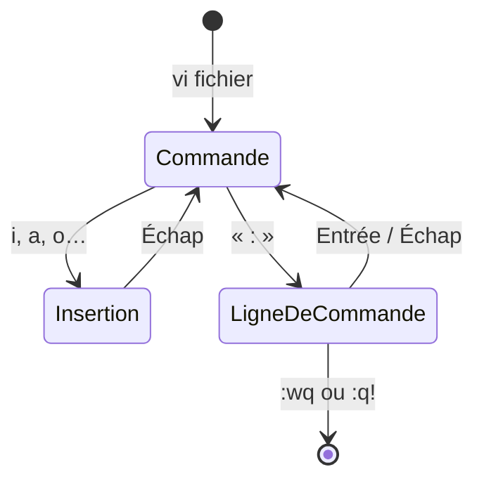

[← Chapitre précédent](04-Rechercher-grep-find.md) · [Sommaire](Readme.md) · [Chapitre suivant →](06-Permissions.md)

# Éditer avec vi

**vi** est l'éditeur de texte standard d'Unix : il est présent sur
pratiquement tous les systèmes, y compris les plus minimalistes. Sous
GNU/Linux, on utilise le plus souvent **vim** (*Vi IMproved*), qui en reprend
les principes et les enrichit.

## 🎯 Objectifs du chapitre

- Comprendre les modes de vi
- Ouvrir, enregistrer et quitter un fichier
- Naviguer, insérer, copier, coller, supprimer, substituer
- Personnaliser vim

---

## 1. Mode compatible et non compatible

vim peut fonctionner :

- en **mode compatible** : il se comporte comme le vi standard d'Unix ;
- en **mode non compatible** : il active ses fonctionnalités enrichies.

Le mode non compatible est le plus confortable, mais gardez en tête que sur
un Unix minimal, vous n'aurez que vi : les commandes de base de ce chapitre
fonctionnent partout.

---

## 2. Les modes de travail



- **Mode commande** (au démarrage) : les touches sont des **commandes** — se déplacer, copier, supprimer…
- **Mode insertion** : les touches **saisissent du texte**.
- **Ligne de commande**, depuis le mode commande, par `:` : enregistrer, quitter, substituer…

La touche **Échap** ramène toujours au mode commande. Dans le doute :
Échap.

---

## 3. Ouvrir, enregistrer, quitter

```bash
vi fichier          # ouvrir (ou créer)
vi -R fichier       # en lecture seule
vi +25 fichier      # positionné à la ligne 25
vi +/Listen fichier # positionné sur la première occurrence de « Listen »
```

| Commande | Effet |
|---|---|
| `:w` | enregistrer |
| `:wq` ou `:x` | enregistrer et quitter |
| `:q` | quitter (refusé s'il y a des modifications) |
| `:q!` | quitter **sans enregistrer** — le `!` force la commande |
| `:!cmd` | exécuter une commande shell sans quitter vi (`:!date`) |

---

## 4. Se déplacer et chercher

| Touche | Effet |
|---|---|
| `h` `j` `k` `l` (ou les flèches) | gauche, bas, haut, droite |
| `w` / `b` | mot suivant / précédent |
| `0` / `$` | début / fin de ligne |
| `gg` | début du fichier |
| `G` | fin du fichier |
| `:n` | aller à la ligne n |
| `:$` | aller à la dernière ligne |
| `/texte` | rechercher « texte » vers le bas |
| `n` / `N` | occurrence suivante / précédente |

---

## 5. Insérer

| Touche | Passe en insertion… |
|---|---|
| `i` | avant le curseur |
| `a` | après le curseur |
| `I` | en début de ligne (premier caractère non blanc) |
| `A` | en fin de ligne |
| `o` | sur une nouvelle ligne, en dessous |
| `O` | sur une nouvelle ligne, au-dessus |
| `s` | en remplaçant le caractère sous le curseur |

---

## 6. Couper, copier, coller, annuler

| Touche | Effet |
|---|---|
| `x` | couper le caractère sous le curseur |
| `dd` | couper la ligne |
| `5dd` | couper 5 lignes |
| `dw` | couper jusqu'à la fin du mot |
| `yy` | copier la ligne |
| `5yy` | copier 5 lignes |
| `p` / `P` | coller après / avant la ligne courante |
| `3p` | coller 3 fois |
| `u` | annuler |
| `Ctrl+R` | rétablir |
| `.` | répéter la dernière modification |

---

## 7. Substituer

| Commande | Effet |
|---|---|
| `cw` | remplacer le mot courant (*change word*) |
| `:s/ancien/nouveau/` | remplacer la première occurrence de la ligne |
| `:s/ancien/nouveau/g` | remplacer toutes les occurrences de la ligne |
| `:%s/ancien/nouveau/g` | remplacer dans **tout le fichier** |
| `:%s/ancien/nouveau/gc` | idem, avec confirmation à chaque occurrence |
| `:%s/motif//gn` | **compter** les occurrences de « motif » |

---

## 8. Personnaliser vim

**Temporairement**, en ligne de commande :

```text
:set number      afficher les numéros de ligne
:set nonumber    les masquer
:syntax on       coloration syntaxique
```

**Durablement**, dans le fichier `~/.vimrc` :

```vim
" Fichier de configuration de vim
set number          " numéros de ligne
set autoindent      " indentation automatique
set ignorecase      " recherche insensible à la casse
set showmode        " afficher le mode courant
syntax on           " coloration syntaxique
```

---

## ✅ Exercice

1. Copiez `/etc/services` dans votre répertoire personnel et ouvrez la copie avec vi.
2. Allez à la ligne 30, puis à la fin du fichier, puis au début.
3. Cherchez la ligne du service `ssh`.
4. Comptez les occurrences de `tcp`.
5. Remplacez toutes les occurrences de `tcp` par `TCP`, enregistrez et quittez.
6. Rouvrez le fichier, supprimez trois lignes avec `3dd`, puis quittez **sans enregistrer**.

<details>
<summary>Voir la correction</summary>

```text
cp /etc/services ~ && vi ~/services
:30   puis   G   puis   gg
/ssh
:%s/tcp//gn
:%s/tcp/TCP/g
:wq
vi ~/services   puis   3dd   puis   :q!
```

</details>

---

[← Chapitre précédent](04-Rechercher-grep-find.md) · [Sommaire](Readme.md) · [Chapitre suivant →](06-Permissions.md)
