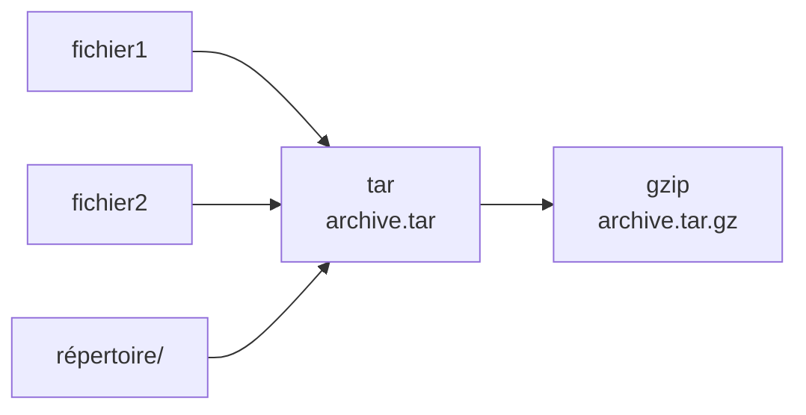

[← Chapitre précédent](06-Permissions.md) · [Sommaire](Readme.md) · [Chapitre suivant →](08-Redirections-et-pipes.md)

# Archivage et compression

## 🎯 Objectifs du chapitre

- Distinguer archivage et compression
- Créer, lister, mettre à jour et extraire une archive avec `tar`
- Compresser et décompresser avec `gzip` et `bzip2`

---

## 1. Archiver ou compresser ?

| | Archivage | Compression |
|---|---|---|
| Principe | concaténer plusieurs fichiers et répertoires en **un seul** fichier | **réduire la taille** d'un fichier |
| Taille | inchangée | réduite |
| Intérêt | manipuler toute une arborescence d'un bloc (envoi, téléchargement) | économiser l'espace disque et la bande passante |
| Outil | `tar` | `gzip`, `bzip2`, `xz` |

Les deux se combinent couramment : une archive `.tar` compressée donne un
`.tar.gz` (ou `.tgz`), un `.tar.bz2`…



---

## 2. `tar`

```bash
tar [options] [archive] [fichiers ou répertoires]
```

Une commande `tar` contient **une** opération principale :

| Option | Opération |
|---|---|
| `-c`, `--create` | créer une archive |
| `-t`, `--list` | lister le contenu |
| `-x`, `--extract` | extraire |
| `-u`, `--update` | ajouter les fichiers plus récents que ceux de l'archive |
| `-r`, `--append` | ajouter des fichiers à la fin |
| `-d`, `--diff` | comparer l'archive et les fichiers |
| `-A`, `--concatenate` | ajouter le contenu d'autres archives |

Et des options complémentaires :

| Option | Effet |
|---|---|
| `-f archive` | le fichier d'archive à utiliser — presque toujours présent |
| `-v` | afficher les fichiers traités |
| `-z` | compresser / décompresser avec gzip |
| `-j` | compresser / décompresser avec bzip2 |
| `-C répertoire` | extraire dans ce répertoire |
| `--exclude=motif` | exclure des fichiers |

### Exemples

```bash
tar -cvf sauvegarde.tar projet/                 # archiver
tar -tvf sauvegarde.tar                         # lister
tar -uvf sauvegarde.tar projet/                 # mettre à jour
tar -czvf sauvegarde.tar.gz projet/             # archiver + gzip
tar -cjvf sauvegarde.tar.bz2 projet/            # archiver + bzip2
tar -cvf sauvegarde.tar --exclude=projet/tmp projet/   # avec exclusion
tar -xzvf sauvegarde.tar.gz -C /tmp/restau      # extraire ailleurs
```

> 💡 Moyen mnémotechnique : **c**rée, **x**trait, **t**able des matières ;
> **z** pour gzip, **j** pour bzip2, **v** pour voir, **f** pour le fichier.

---

## 3. `gzip` et `bzip2`

Les deux compressent fichier par fichier, et **remplacent** l'original par sa
version compressée.

| | gzip | bzip2 |
|---|---|---|
| Extension | `.gz` | `.bz2` |
| Vitesse | rapide | plus lent |
| Taux de compression | bon | meilleur |

```bash
gzip fichier.log            # → fichier.log.gz
bzip2 fichier.log           # → fichier.log.bz2
```

| Option | gzip | bzip2 |
|---|---|---|
| Écrire sur la sortie standard, garder l'original | `-c` | `-c` |
| Garder l'original | `-k` | `-k` |
| Forcer, même si le fichier compressé existe | `-f` | `-f` |
| Afficher les statistiques | `-v` | `-v` |
| Compression la plus rapide / la meilleure | `-1` / `-9` | `-1` / `-9` (blocs de 100 à 900 Ko) |
| Décompresser | `-d` | `-d` |
| Lister le contenu d'un `.gz` | `-l` | — |

---

## 4. Décompresser

| Commande | Effet |
|---|---|
| `gunzip fichier.gz` | décompresser un `.gz` |
| `zcat fichier.gz` | afficher le contenu d'un `.gz` sans le décompresser sur disque |
| `bunzip2 fichier.bz2` | décompresser un `.bz2` |
| `bzcat fichier.bz2` | afficher le contenu d'un `.bz2` |

```bash
zcat /var/log/syslog.2.gz | grep 'error'    # chercher dans un journal archivé
```

---

## ✅ Exercice

1. Archivez et compressez `/etc` avec gzip dans `~/etc.tar.gz` (avec `sudo`).
2. Listez le contenu de l'archive, et comptez ses fichiers.
3. Extrayez-la dans `/tmp/etc-restau`.
4. Comparez la taille de l'archive avec celle de `/etc`.

<details>
<summary>Voir la correction</summary>

```bash
sudo tar -czf ~/etc.tar.gz /etc
tar -tzf ~/etc.tar.gz | wc -l
mkdir -p /tmp/etc-restau && sudo tar -xzf ~/etc.tar.gz -C /tmp/etc-restau
ls -lh ~/etc.tar.gz && sudo du -sh /etc
```

</details>

---

[← Chapitre précédent](06-Permissions.md) · [Sommaire](Readme.md) · [Chapitre suivant →](08-Redirections-et-pipes.md)
