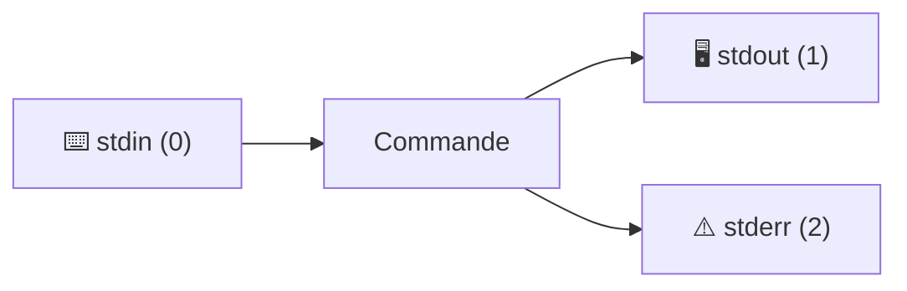
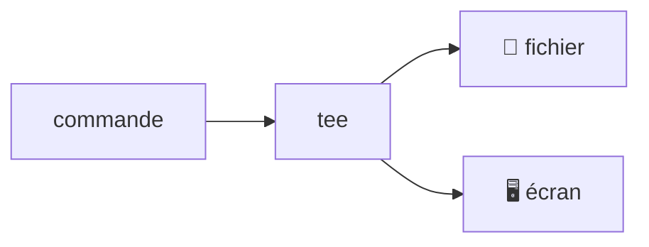

[← Chapitre précédent](07-Archivage-et-compression.md) · [Sommaire](Readme.md) · [Chapitre suivant →](09-Processus.md)

# Redirections et pipes

## 🎯 Objectifs du chapitre

- Connaître les trois flux standard
- Rediriger l'entrée, la sortie et les erreurs d'une commande
- Enchaîner les commandes avec des pipes
- Dupliquer une sortie avec `tee`

---

## 1. Les trois flux standard

Toute commande dispose de trois flux, numérotés :

| N° | Flux | Par défaut |
|---|---|---|
| 0 | **stdin** — entrée standard | le clavier |
| 1 | **stdout** — sortie standard | l'écran |
| 2 | **stderr** — sortie d'erreur | l'écran |



Chacun peut être **redirigé**, vers ou depuis un fichier.

---

## 2. Les redirections

### Entrée

```bash
commande < fichier          # lire l'entrée dans un fichier
wc -l < /etc/passwd

commande << FIN             # « here document » : saisir jusqu'au mot-clé
cat << FIN > note.txt
première ligne
deuxième ligne
FIN
```

### Sortie standard

```bash
commande > fichier          # écraser le fichier (équivaut à 1>)
commande >> fichier         # ajouter à la fin (équivaut à 1>>)
ls -l /etc > liste.txt
date >> journal.txt
```

### Sortie d'erreur

```bash
commande 2> erreurs.txt     # écraser
commande 2>> erreurs.txt    # ajouter
find / -name passwd 2> /dev/null      # ignorer les erreurs « Permission non accordée »
```

### Les deux à la fois

```bash
commande > sortie.txt 2>&1  # erreurs redirigées au même endroit que la sortie
commande &> tout.txt        # raccourci bash équivalent
```

### `/dev/null`

`/dev/null` est le « trou noir » du système : tout ce qu'on y écrit
disparaît. On l'utilise pour se débarrasser d'une sortie dont on n'a pas
besoin.

> ⚠️ `>` écrase sans prévenir. Une faute de frappe dans `>` au lieu de `>>`
> vide le fichier.

---

## 3. Les pipes

Le **pipe** `|` branche la sortie standard d'une commande sur l'entrée
standard de la suivante.


```bash
ls -l /etc | less                       # paginer une longue sortie
cat /etc/passwd | wc -l                 # compter les lignes
grep 'sshd' /var/log/auth.log | tail -n 20
ps -ef | grep nginx
cut -d: -f7 /etc/passwd | sort | uniq -c   # combien de comptes par shell ?
```

On peut enchaîner autant de pipes que nécessaire : c'est la force de la
ligne de commande Unix, où chaque outil fait une seule chose, bien.

---

## 4. Dupliquer la sortie : `tee`

`tee` écrit ce qu'il reçoit **à la fois** dans un fichier et sur sa sortie
standard : on voit le résultat et on le garde.



```bash
ls -l /etc | tee liste.txt              # afficher et enregistrer
ls -l /var | tee -a liste.txt           # afficher et ajouter (-a)
echo "nameserver 1.1.1.1" | sudo tee -a /etc/resolv.conf   # écrire dans un fichier root
```

> 💡 Le dernier exemple est un classique : `sudo echo … > fichier` échoue,
> car la redirection est faite par votre shell, sans les droits root. `tee`,
> lancé par `sudo`, les a.

---

## ✅ Exercice

1. Enregistrez la liste des fichiers de `/etc` dans `etc.txt`, puis ajoutez-y la date du jour.
2. Lancez `ls /etc /inexistant` en envoyant la sortie dans `ok.txt` et les erreurs dans `ko.txt`.
3. Affichez les 5 plus gros fichiers de `/var/log`.
4. Comptez les utilisateurs dont le shell est `/usr/sbin/nologin`.

<details>
<summary>Voir la correction</summary>

```bash
ls /etc > etc.txt && date >> etc.txt
ls /etc /inexistant > ok.txt 2> ko.txt
sudo du -a /var/log | sort -n -r | head -n 5
grep -c '/usr/sbin/nologin$' /etc/passwd
```

</details>

---

[← Chapitre précédent](07-Archivage-et-compression.md) · [Sommaire](Readme.md) · [Chapitre suivant →](09-Processus.md)
