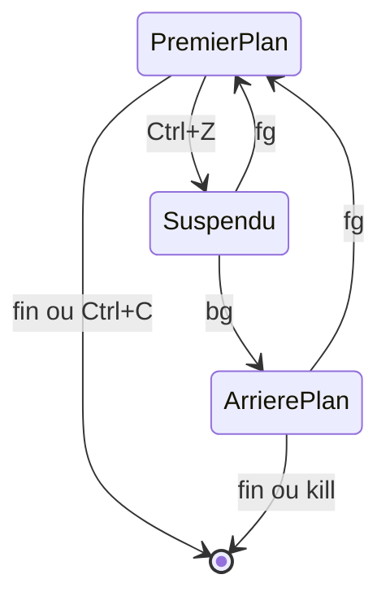

[← Chapitre précédent](08-Redirections-et-pipes.md) · [Sommaire](Readme.md) · [Chapitre suivant →](10-Environnement-du-shell.md)

# Les processus

Un **processus** est un programme en cours d'exécution. Ouvrir une session
ou lancer une commande crée un processus ; un utilisateur peut en exécuter
plusieurs à la fois, au premier plan ou en arrière-plan. Chacun est
identifié par un numéro unique, le **PID** (*Process Identifier*).

## 🎯 Objectifs du chapitre

- Observer les processus avec `ps`, `pstree`, `top` et `pgrep`
- Envoyer un signal à un processus avec `kill`
- Mesurer la durée d'une commande avec `time`
- Lancer et suivre des processus en arrière-plan

---

## 1. Observer les processus

### `ps` : instantané

Par défaut, `ps` affiche les processus du terminal courant, avec les colonnes
PID, TTY, TIME et CMD.

```bash
ps              # processus du terminal courant
ps -ef          # tous les processus, format complet
ps aux          # idem, syntaxe BSD, avec %CPU et %MEM
ps -u nsahuc    # processus d'un utilisateur
```

| Option | Effet |
|---|---|
| `-e` | tous les processus |
| `-f` | format complet : UID, PPID (PID du parent), STIME (heure de lancement)… |
| `-u nom` | processus de cet utilisateur |
| `a` | processus de tous les utilisateurs (syntaxe BSD) |
| `x` | processus sans terminal de contrôle (services) |

### `pstree` : l'arbre des processus

Chaque processus a un **parent** : `pstree` affiche leur filiation.

```bash
pstree          # arbre complet
pstree -p       # avec les PID
pstree -u       # avec les utilisateurs
```

### `top` : en temps réel

`top` affiche une vue dynamique des processus, triée par consommation CPU.

| Touche | Effet |
|---|---|
| `h` | aide |
| `M` | trier par mémoire |
| `P` | trier par CPU |
| `k` | envoyer un signal à un PID |
| `q` | quitter |

> 💡 `htop`, à installer, offre la même chose en plus lisible.

### `pgrep` : trouver un PID

```bash
pgrep -l ssh        # PID et nom des processus dont le nom contient « ssh »
pgrep -u nsahuc     # PID des processus d'un utilisateur
```

---

## 2. Envoyer un signal : `kill`

`kill` envoie un **signal** à un processus désigné par son PID. Seuls son
propriétaire et root peuvent le faire.

```bash
kill 1234           # demande polie d'arrêt (signal 15)
kill -9 1234        # arrêt immédiat, inconditionnel
pkill nginx         # par nom plutôt que par PID
```

| Signal | Nom | Effet |
|---|---|---|
| 15 | SIGTERM | demande de terminaison : le processus peut se fermer proprement (défaut) |
| 2 | SIGINT | interruption — l'équivalent de `Ctrl+C` |
| 9 | SIGKILL | arrêt immédiat, que le processus ne peut ni intercepter ni ignorer |

> ⚠️ Essayez toujours `kill` (15) avant `kill -9` : un arrêt brutal peut
> laisser des fichiers corrompus ou des verrous orphelins.

---

## 3. Mesurer : `time`

```bash
time find / -name '*.conf' 2> /dev/null
```

| Mesure | Signification |
|---|---|
| `real` | temps réel écoulé depuis le lancement |
| `user` | temps CPU passé en mode utilisateur |
| `sys` | temps CPU passé en mode système (noyau) |

---

## 4. Premier plan et arrière-plan

Un processus lancé en **arrière-plan** rend la main immédiatement : on
continue à travailler pendant qu'il tourne. Mieux vaut alors rediriger ses
sorties, pour ne pas les mélanger à son travail et pour en garder trace.

```bash
commande &                                  # lancer en arrière-plan
tar -czf sauvegarde.tar.gz /home > tar.log 2>&1 &
```

### Gérer les jobs

| Commande | Effet |
|---|---|
| `jobs` | lister les jobs du shell courant (`-l` : avec leur PID) |
| `Ctrl+Z` | suspendre le processus au premier plan |
| `bg %1` | relancer le job 1 en arrière-plan |
| `fg %1` | ramener le job 1 au premier plan |
| `kill %1` | arrêter le job 1 |

Dans la sortie de `jobs` :

```text
[1]-  En cours d'exécution   sleep 300 &
[2]+  Stoppé                 vi notes.txt
```

- `[n]` : numéro du job ;
- `+` : job le plus récent ; `-` : celui d'avant ;
- l'état : en cours, stoppé, terminé.



---

## ✅ Exercice

1. Lancez `sleep 600` en arrière-plan, puis `sleep 900` au premier plan, que vous suspendez.
2. Listez vos jobs, relancez le second en arrière-plan.
3. Retrouvez les PID de vos `sleep` avec `pgrep`, puis arrêtez-les.
4. Affichez l'arbre de vos processus.

<details>
<summary>Voir la correction</summary>

```bash
sleep 600 &
sleep 900          # puis Ctrl+Z
jobs -l
bg %2
pgrep -l sleep
kill %1 %2         # ou kill <PID1> <PID2>
pstree -p $USER
```

</details>

---

[← Chapitre précédent](08-Redirections-et-pipes.md) · [Sommaire](Readme.md) · [Chapitre suivant →](10-Environnement-du-shell.md)
